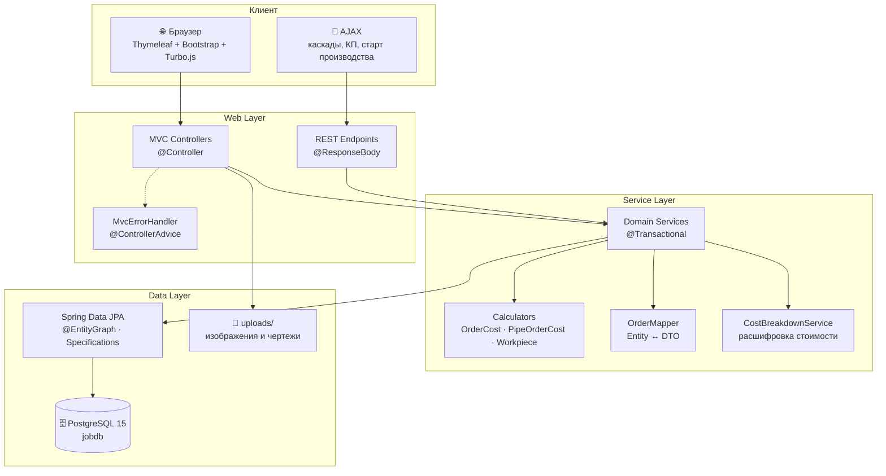
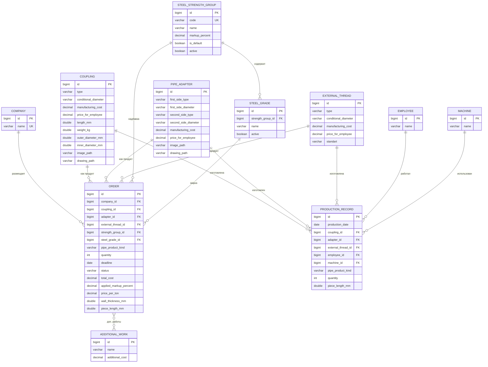
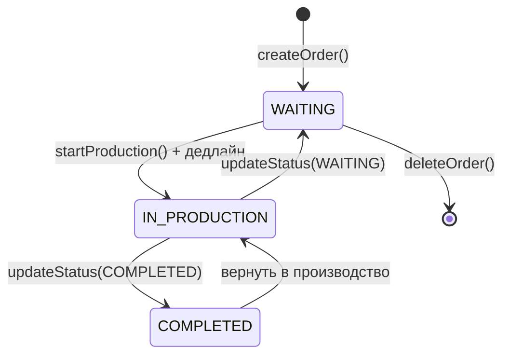
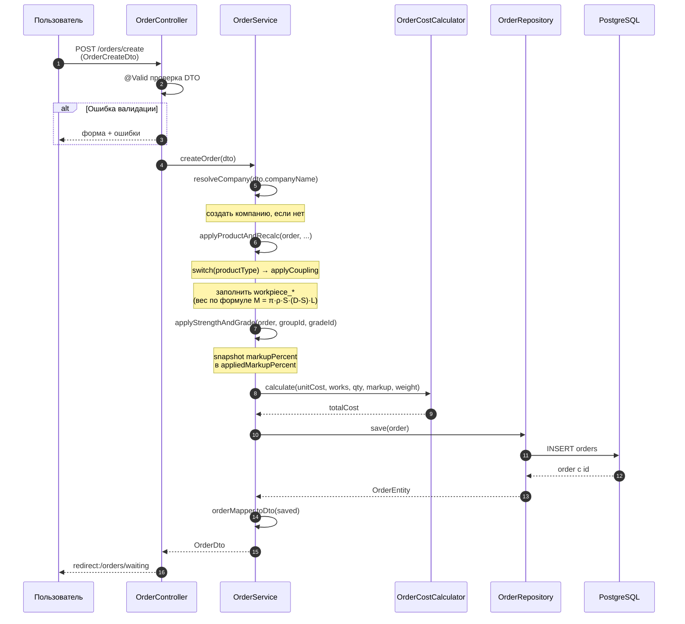
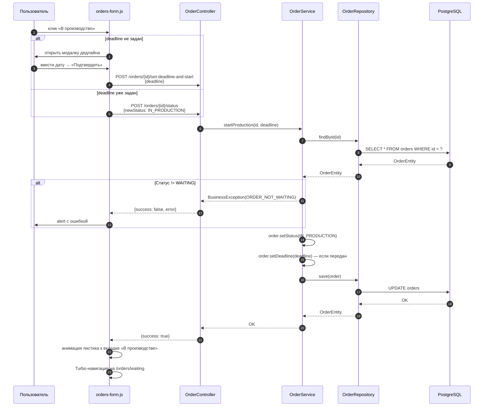
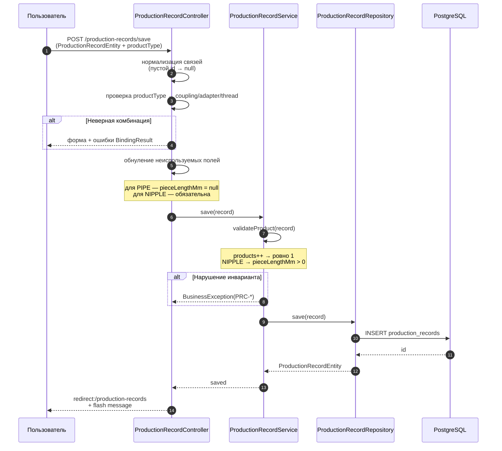

# 🏭 Job — ERP для нефтегазового производства


> **Информационная система для предприятия по изготовлению трубной продукции нефтегазового сортамента:**
> справочники изделий, оформление заказов, журнал производства, отчётность и коммерческие предложения.

<!--
📸 SLOT 1: docs/screenshots/02-home.png — дашборд главной страницы

-->

---

## 📋 Бизнес-контекст

Предприятие изготавливает изделия для нефтегазовой отрасли — **муфты, переводники, трубы и патрубки** с наружными резьбами (НКТ, ОТТМ, ОТТГ и др.). Менеджер оформляет заказы от компаний-заказчиков, цех ведёт журнал изготовления (кто, на каком станке, сколько сделал), а руководство получает отчёты по заработку сотрудников и загрузке станков.

**Система автоматизирует полный цикл:**

```
Справочники → Заказ → Коммерческое предложение → Производство → Журнал → Отчёты
```

Ключевая особенность — **динамический расчёт стоимости** каждой позиции: с учётом цены изготовления, веса металла, надбавки за группу прочности стали и весозависимых дополнительных работ (минимум 100 кг тарификации).

---

## 🛠️ Технологический стек

| Слой | Технология | Назначение |
|---|---|---|
| **Язык** | Java 17 | LTS, `switch`-выражения, `record`, `text blocks` |
| **Фреймворк** | Spring Boot 3.x | DI, автоконфигурация, стартеры |
| **Web (MVC)** | Spring MVC + Thymeleaf | Server-side рендеринг страниц |
| **Web (REST)** | Spring Web | JSON-эндпоинты для AJAX-каскадов и КП |
| **Безопасность** | Spring Security | Аутентификация, 4 роли (ADMIN / MANAGER / MASTER / WORKER) |
| **ORM** | Spring Data JPA + Hibernate | Репозитории, `@EntityGraph`, Specifications |
| **БД** | PostgreSQL 15 | Надёжная реляционная СУБД |
| **Миграции** | Liquibase | Декларативные миграции, снимок + 15 эволюционных changeset'ов |
| **Валидация** | Jakarta Bean Validation | `@NotBlank`, `@Positive`, `@AssertTrue` для cross-field |
| **UI** | Bootstrap 5 + Thymeleaf fragments | Адаптивные страницы |
| **UI-навигация** | Hotwire Turbo 8 | SPA-эффект без SPA-фреймворка |
| **UX-фичи** | Custom JS (1500+ строк) | Live-калькулятор, WoW-тултипы, анимации |
| **Файлы** | Локальная ФС (`uploads/`) | Изображения изделий и чертежи (PDF/JPG/PNG) |
| **Контейнеризация** | Docker + docker-compose | Воспроизводимый запуск |
| **События (опц.)** | Kafka | Задел на event-driven (флаг `kafka.enabled`) |
| **Мониторинг** | Spring Actuator | Healthcheck для Docker |

---

## 🏗️ Архитектура

Проект построен по классической **слоистой архитектуре** с разделением на **MVC-слой** (Thymeleaf-страницы) и **REST-слой** (JSON для AJAX и внешних клиентов).



### Описание слоёв

**Web Layer.** `controller/mvc/*` — возвращают View через `contentTemplate` (фрагмент Thymeleaf, подставляемый в `layout.html`). `controller/rest/*` — возвращают JSON. Ошибки бизнес-логики обрабатываются в `MvcErrorHandler` через `@ControllerAdvice`: пользователь остаётся в UI и видит flash-сообщение вместо «белого экрана».

**Service Layer.** Бизнес-логика: создание/редактирование заказов, старт производства, журнал, отчёты. Все операции — `@Transactional`. Расчёт стоимости **изолирован** в калькуляторах (`util/*CostCalculator`) — единственное место, где живут формулы.

**Data Layer.** Репозитории Spring Data JPA. Точечный `@EntityGraph` на методах, где он нужен для избежания N+1 (списки заказов, журнал, справочник групп прочности). Динамические фильтры журнала — через `JpaSpecificationExecutor`.

---

## 📁 Структура проекта

```
src/main/java/ProjectForJob/example/Job/
├── configuration/              # Spring-конфигурация
│   ├── SecurityConfig          # Spring Security + роли
│   ├── WebConfig               # /uploads/** → файловая система
│   ├── WebMvcConfig            # interceptors
│   ├── KafkaConfig             # producer (флаг kafka.enabled)
│   └── GlobalControllerAdvice  # currentUri в модель
│
├── controller/
│   ├── mvc/
│   │   ├── handbook/           # Справочники: муфты, переводники, резьбы…
│   │   ├── journal/            # Журнал производства и отчёты
│   │   ├── order/              # Заказы и коммерческие предложения
│   │   ├── handler/            # MvcErrorHandler
│   │   ├── HomeController      # Дашборд
│   │   └── LoginController     # Вход
│   └── rest/
│       └── EmployeesController # REST-пример для справочника
│
├── domain/entity/
│   ├── handbook/               # Coupling, PipeAdapter, ExternalThread,
│   │                           # SteelStrengthGroup, SteelGrade,
│   │                           # Employee, Machine, AdditionalWork
│   ├── journal/                # ProductionRecord
│   └── order/                  # Order, Company, OrderStatus, PipeProductKind
│
├── dto/                        # OrderDto, OrderCreateDto, CostBreakdownDto…
│   └── kafka/                  # OrderStartedEvent, AdditionalWorkDto
│
├── exception/                  # Иерархия BusinessException
│   ├── ErrorCode               # интерфейс: code + HttpStatus + message
│   ├── BusinessException       # базовое доменное
│   ├── service/order/          # OrderErrorCode (ORD-*)
│   ├── service/journal/        # ProductionRecordErrorCode (PRC-*)
│   └── util/                   # CalculatorErrorCode (CALC-*) + factory
│
├── repository/
│   ├── handbook/               # JPA-репозитории справочников
│   ├── journal/                # ProductionRecordRepository
│   └── order/                  # OrderRepository, CompanyRepository
│
├── service/
│   ├── handbook/               # CRUD-сервисы справочников
│   ├── mapper/OrderMapper      # Entity ↔ DTO + Kafka events
│   ├── OrderService            # Ядро домена заказов
│   ├── ProductionRecordService # Журнал + Specifications
│   ├── CostBreakdownService    # Расшифровка стоимости
│   └── KafkaProducerService    # (задел на event-driven)
│
├── util/                       # Чистые функции без Spring
│   ├── WorkpieceCalculator     # M = π·ρ·S·(D-S)·L / 1e6
│   ├── OrderCostCalculator     # COUPLING/ADAPTER
│   └── PipeOrderCostCalculator # PIPE/NIPPLE
│
└── web/interceptor/            # GlobalModelInterceptor

src/main/resources/
├── db/changelog/               # Liquibase (master + 15 xml)
├── templates/
│   ├── welcomeToHome/          # layout.html, welcome.html
│   └── fragments/              # Фрагменты по модулям
└── application.properties

src/test/java/ProjectForJob/example/Job/
├── service/
│   ├── OrderServiceTest        # ~60 тестов (Nested)
│   ├── ProductionRecordServiceTest
│   └── mapper/OrderMapperTest
└── util/
    ├── WorkpieceCalculatorTest
    ├── OrderCostCalculatorTest
    └── PipeOrderCostCalculatorTest
```


---

## 🗂️ Доменная модель

Система оперирует тремя группами сущностей: **справочники** (что можем изготавливать), **заказы** (что заказали) и **журнал производства** (что реально сделали).



**Ключевые особенности модели:**

- **Четыре типа продукции в одной модели.** `Order` и `ProductionRecord` оба имеют 4 nullable-FK (`coupling_id`, `adapter_id`, `external_thread_id`) + enum-дискриминатор `pipe_product_kind` для труб. Инвариант «ровно один продукт задан» защищается на 4 уровнях (DTO → сервис → сущность → БД-логика).
- **Snapshot-паттерн.** `Order.applied_markup_percent` — снимок процента надбавки из справочника на момент создания заказа. Изменение справочника **не пересчитывает** старые заказы.
- **Дополнительные работы — M:N.** `order_additional_work` связывает заказ с работами. Цена работы хранится **за тонну**, а не за штуку — тарификация умножается на вес заказа (минимум 100 кг).
- **Журнал независим от заказов.** `ProductionRecord` не ссылается на `Order` — это отдельный учёт фактов. Запись журнала может быть создана без заказа (корректировка, брак, доделка).

---

## 🧠 Ключевые архитектурные решения

Раздел для тех, кто хочет понять **почему** сделано именно так. Это то, что отличает «работает» от «продумано».

### 1. Полиморфная модель продукта (4 типа через nullable-FK + enum)

**Проблема.** Заказ может быть на муфту, переводник, трубу или патрубок. Классические варианты:
- 4 отдельные таблицы `order_couplings`, `order_adapters`, ... → сложные JOIN'ы, дублирование полей
- Один FK + иерархия через `@Inheritance` → проблемы с JPA, сложные запросы
- JSON-поле `product_data` → теряется типизация

**Решение.** Одна таблица `orders` с четырьмя nullable-FK + `pipe_product_kind` для дискриминации труб:

```java
@ManyToOne @JoinColumn(name = "coupling_id")        private CouplingEntity coupling;
@ManyToOne @JoinColumn(name = "adapter_id")         private PipeAdapterEntity adapter;
@ManyToOne @JoinColumn(name = "external_thread_id") private ExternalThreadEntity externalThread;
@Enumerated(EnumType.STRING) @Column(name = "pipe_product_kind") private PipeProductKind pipeProductKind;
```

**Инвариант «ровно один продукт» защищается в 4 слоях** — защита в глубину:

| Слой | Как |
|---|---|
| **DTO-валидация** | `@AssertTrue isProductValid()` — cross-field Bean Validation |
| **Сервис** | `switch(productType)` в `applyProductAndRecalc` + очистка неиспользуемых полей |
| **Entity** | `getProductType()` — инкапсулирует логику выбора |
| **Журнал** | `ProductionRecordService.validateProduct()` — явный подсчёт `products++` |

**Плюс:** `OrderMapper` инкапсулирует развилку в `record ProductInfo` — контроллеры и шаблоны не знают деталей.

---

### 2. Snapshot процента надбавки — защита от «плавающих» цен

**Проблема.** `SteelStrengthGroup.markupPercent` — процент надбавки за группу прочности стали. Если завтра менеджер изменит процент в справочнике, **все старые заказы пересчитаются**, хотя они уже согласованы с клиентом.

**Решение.** При создании/редактировании заказа процент **фиксируется** в поле `Order.appliedMarkupPercent`:

```java
order.setAppliedMarkupPercent(group.getMarkupPercent() != null
    ? group.getMarkupPercent() : BigDecimal.ZERO);
```

При расчёте стоимости используется **снимок**, а не текущее значение справочника. Изменение справочника влияет только на **новые** заказы.

**Покрыто интеграционным тестом** внутри `OrderServiceTest`:

```java
@DisplayName("ИНТЕГРАЦИЯ: надбавка доезжает до totalCost (500×20 + 10% = 11000)")
```

---

### 3. Live-калькулятор стоимости — UX-фича с осознанным дублированием

**Фича.** Менеджер заполняет форму создания заказа — и **сразу видит**, как меняется итоговая стоимость с пошаговой расшифровкой: `unitCost × Q`, надбавка, нарезка резьбы, металл, доп. работы. Без нажатия «Сохранить».

**Как устроено.** Формулы живут в трёх местах:

| Место | Роль |
|---|---|
| `OrderCostCalculator` / `PipeOrderCostCalculator` (Java) | **Финал** — сохраняется в `order.totalCost` |
| `CostBreakdownService` (Java) | **Расшифровка** на странице просмотра и в КП |
| `orders-form.js` (JS) | **Предпросмотр** в live-калькуляторе на форме |

**Дублирование осознанное.** Клиент не может дёргать сервер на каждое нажатие клавиши — иначе UX станет «дёрганым». Компромисс: клиент считает предпросмотр локально, сервер — authoritative расчёт при сохранении.

**Комментарий в коде** (в `CostBreakdownService`):
> «Формулы 1-в-1 совпадают с фронтовым live-калькулятором»

**Риск:** если кто-то изменит формулу в одном месте и забудет про другие — расхождение. См. Roadmap: тест на синхронность / вынос формул в endpoint `/api/calculate-preview`.

---

### 4. Расчёт стоимости — чистые функции, изолированные от бизнес-логики

Формулы живут в **трёх final-классах** без Spring-аннотаций — их легко тестировать и переиспользовать.

**`WorkpieceCalculator`** — теоретический вес круглой трубы:

```
M = π · ρ · S · (D − S) · L / 1_000_000
где: ρ = 7850 кг/м³ (плотность стали), S — стенка, D — диаметр, L — длина
```

**`OrderCostCalculator`** — для муфт и переводников:

```
baseCost   = unitCost × quantity
markupCost = baseCost × markup% / 100
billingW   = max(weightKg, 100)              ← минимум 100 кг
worksCost  = Σ(price) × billingW / 1000
totalCost  = baseCost + markupCost + worksCost
```

**`PipeOrderCostCalculator`** — для труб и патрубков:

```
threadsCost = threadCost × 2 × quantity      ← нарезка с двух сторон
metalCost   = pricePerTon × weightKg / 1000
baseCost    = threadsCost + metalCost
markupCost  = baseCost × markup% / 100
billingW    = max(weightKg, 100)             ← ТОЛЬКО для работ
worksCost   = Σ(price) × billingW / 1000
totalCost   = baseCost + markupCost + worksCost
```

**Ключевая тонкость** (покрыта отдельным `@Nested` в тестах): **вес для металла и вес для работ — разные**. Металл считается от **реального** веса (0 → 0), а доп. работы — от **`max(weight, 100)`** (минимальная тарификация).

**Округление:** `scale=4` на промежуточных шагах (защита от накопления дробей), `scale=2` на финале (`HALF_UP`). Все денежные величины — `BigDecimal`.

---

### 5. Унифицированная иерархия ошибок — `ErrorCode` как интерфейс

**Проблема.** С ростом домена растёт число ошибок. Если каждая — отдельный класс исключения, `@ExceptionHandler` разрастается.

**Решение.** Базовый `BusinessException` хранит **`ErrorCode` — интерфейс** с тремя полями:

```java
public interface ErrorCode {
    String getCode();          // "ORD-001", "CALC-003", "PRC-010"
    HttpStatus getStatus();    // 400, 404, 409...
    String getMessage();       // человекочитаемое
}
```

**Три enum-реализации с префиксами:**
- `OrderErrorCode` (`ORD-*`) — бизнес-логика заказов
- `CalculatorErrorCode` (`CALC-*`) — калькуляторы (утилитный, независим от домена)
- `ProductionRecordErrorCode` (`PRC-*`) — журнал производства

**Один `MvcErrorHandler`** ловит **любой** `BusinessException` → flash-сообщение + redirect. При добавлении нового домена — не меняется.

**Фабрика `CalculatorErrors`** централизует формирование сообщений:

```java
public static CalculatorException wallExceedsDiameter(double d, double s) {
    return new CalculatorException(
        CalculatorErrorCode.WALL_EXCEEDS_DIAMETER,
        "Толщина стенки (%.2f мм) не может быть больше наружного диаметра (%.2f мм)"
            .formatted(s, d));
}
```

---


### 6. SPA-эффект через Turbo.js — без SPA-фреймворка

**Фича.** Навигация между страницами происходит **без полной перезагрузки** — как в SPA. Но реализовано на **серверном рендеринге + Turbo 8**, без React/Vue/Angular.

**Как устроено:**

```html
<turbo-frame id="app" data-turbo-action="advance">
    <div th:replace="~{__${contentTemplate}__}"></div>
</turbo-frame>
```

Каждый контроллер передаёт `contentTemplate` (фрагмент Thymeleaf), layout подставляет его в `<turbo-frame>`. Все ссылки и формы помечены `data-turbo-frame="app"`.

**Точечная работа с Turbo:**
- `data-turbo="false"` на dropdown-меню и logout-формах — там Turbo ломает поведение
- `<meta name="turbo-cache-control" content="no-preview">` — отключение превью
- События `turbo:load`, `turbo:frame-load` — переинициализация JS-модулей
- Обёртка `history.pushState` — синхронизация подсветки навбара

**Плюс:** `data-smart-back` — «умная» кнопка «Назад», которая возвращает пользователя на список, откуда он пришёл (через `sessionStorage`), с fallback по статусу заказа.

---

### 7. UX-фичи, которые запоминаются

Это не «обязательно для работы», но то, что делает продукт **узнаваемым**:

**4-цветная кодировка продуктов** — визуальная навигация:
- 🟣 Муфта (`product-icon-tile--coupling`)
- 🟠 Переводник (`--adapter`)
- 🔵 Патрубок (`--nipple`)
- 🟢 Труба (`--pipe`)

**Тултипы в стиле WoW** — при наведении на название продукта появляется карточка с «редкостью»:

| Продукт | Редкость | Цвет |
|---|---|---|
| Труба / резьба | uncommon | зелёный |
| Патрубок | rare | синий |
| Муфта | epic | фиолетовый |
| Переводник | legendary | оранжевый |

Внутри — вес, диаметры, цены, изображение, эмодзи-иконки (📏 ⚖️ 🔘 🎯). Это **необычно и запоминается**.

**Анимации** (с `prefers-reduced-motion` respect):
- Удаление карточки = схлопывание + листик, улетающий с ветром и искрами
- Перевод заказа между статусами = листик летит от карточки к целевой вкладке
- Комета, обегающая контур активной кнопки навбара

**Live-калькулятор** (см. п. 3) — «фишка» формы заказа.

<!--
📸 SLOT 2: docs/screenshots/08-tooltip.png — WoW-тултип муфты (epic)

*Тултип в стиле WoW: epic-редкость для муфты, с весом, диаметрами и ценами*
-->

---

## 🧩 Функциональность

Система состоит из **пяти модулей**, покрывающих полный цикл производства.

### 📚 Справочники

База знаний предприятия — то, что можно изготавливать и с какими характеристиками.

| Справочник | Что содержит | Особенности |
|---|---|---|
| **Муфты** | Тип, условный диаметр, геометрия, цены | Изображение + чертёж (PDF/JPG/PNG), аккордеон по типам |
| **Переводники** | Обе стороны (тип + диаметр), геометрия, цены | Изображение + чертёж, группировка по первой стороне |
| **Наружные резьбы** | Тип (НКТ/ОТТМ/ОТТГ), условный диаметр, ГОСТ | Числовая сортировка диаметров (73 < 89 < 102) |
| **Группы прочности стали** | Код, процент надбавки, флаг «по умолчанию» | Инвариант «ровно одна дефолтная группа» |
| **Марки стали** | Принадлежат группе, активность | Информационное поле в заказе, на цену не влияет |
| **Доп. работы** | Название, цена за тонну | Тарификация по весу (мин. 100 кг) |
| **Сотрудники** | ФИО | Привязка к записям журнала |
| **Станки** | Название | Привязка к записям журнала |

**UI-фичи справочников:**
- Аккордеон по типам с плавной анимацией `max-height`
- Кликабельные карточки с навигацией внутри `turbo-frame="app"`
- WoW-тултипы с редкостью (epic / legendary)
- Загрузка изображений и чертежей через Base64 + FileReader
- Лайтбокс для чертежей с зумом по клику
- Удаление карточки = схлопывание + листик, улетающий с ветром

<!--
📸 SLOT 3: docs/screenshots/07-couplings.png — справочник муфт

*Справочник муфт: аккордеон по типам, карточки с фото, WoW-тултипы*
-->

---

### 🛒 Заказы

Ядро домена — оформление и жизненный цикл заказа.

**Жизненный цикл:**



**Что умеет:**

| Операция | Как |
|---|---|
| **Создание заказа** | Форма с 4 типами продукции, каскадами AJAX, live-калькулятором |
| **Редактирование** | Полная перестройка продукта + пересчёт всего (не диффинг) |
| **Просмотр** | Карточка с раскрывающейся расшифровкой стоимости |
| **Старт производства** | С указанием дедлайна (через модалку) или без |
| **Смена статуса** | Между WAITING ↔ IN_PRODUCTION → COMPLETED |
| **Удаление** | С анимацией пузыря + листика |

**Расчёт стоимости** — ключевая фича. Развилка по типу продукции:

- **Муфта / переводник** → `unitCost × Q` + надбавка + доп. работы
- **Труба / патрубок** → `(нарезка × 2 × Q) + металл` + надбавка + доп. работы

Подробно — см. «Ключевые решения» п. 4.

**Валидация** — на 3 уровнях:
1. **Клиент** — `required`, `type="number"`, HTML5-валидация
2. **Bean Validation** — `@NotNull`, `@Positive`, `@AssertTrue` для cross-field
3. **Сервис** — guard-проверки на инварианты (`BusinessException`)

<!--
📸 SLOT 4: docs/screenshots/03-orders-waiting.png — список «В ожидании» с панелью КП

*Список «В ожидании» с панелью КП и 4-цветной кодировкой продуктов*
-->

<!--
📸 SLOT 5: docs/screenshots/04-order-create-live.png — live-калькулятор

*Форма создания заказа с раскрытым live-калькулятором — пошаговая расшифровка цены*
-->

<!--
📸 SLOT 6: docs/screenshots/05-order-view-breakdown.png — карточка заказа

*Карточка заказа с раскрытой расшифровкой стоимости*
-->

---

### 📄 Коммерческое предложение (КП)

Сборка нескольких заказов **одной компании** в единый документ для клиента.

**Как работает:**

1. На странице «В ожидании» у каждой карточки — кнопка `+` для добавления в КП
2. `Set<Long>` ID заказов хранится в `HttpSession` под ключом `commercialOffer`
3. При добавлении — проверка, что все заказы **одной компании**
4. На странице КП — таблица позиций + итоговая сумма + **расшифровка по каждой позиции**

**Каждая позиция раскрывается** — с шагами расчёта (те же, что в live-калькуляторе):

```
Стоимость изготовления: unitCost × Q
Надбавка за группу: baseCost × markup%
Нарезка резьбы (для труб): threadCost × 2 × Q
Металл (для труб): pricePerTon × weight / 1000
Доп. работы: Σ(price) × billingWeight / 1000
Итого по позиции
```

<!--
📸 SLOT 7: docs/screenshots/09-commercial-offer.png — КП с расшифровкой

*КП с расшифровкой по каждой позиции*
-->

**Ограничение:** сессионное хранение не масштабируется горизонтально (см. Roadmap).

---

### 📓 Журнал производства

Учёт фактически изготовленной продукции. **Независим от заказов** — запись может быть без заказа.

**Структура записи:**

- Дата изготовления
- Продукт (4 типа — та же полиморфная модель)
- Количество
- Сотрудник
- Станок
- Комментарий
- `createdAt` — автоматически через `@PrePersist`

**Фильтрация** — динамическая, через `JpaSpecificationExecutor`:

| Фильтр | Поле |
|---|---|
| Тип продукции | `pipe_product_kind` / nullable-FK |
| Конкретная муфта | `coupling_id` |
| Конкретный переводник | `adapter_id` |
| Конкретная резьба | `external_thread_id` |
| Сотрудник | `employee_id` |
| Станок | `machine_id` |
| Диапазон дат | `production_date` |

**UI-фичи:**
- Каскадные фильтры «тип → диаметр»
- Пагинация с сохранением фильтров в URL
- Плиточный список с иконками по типу продукта
- Плавное раскрытие панели фильтров

<!--
📸 SLOT 8: docs/screenshots/06-journal.png — журнал производства

*Журнал с фильтрами по типу, сотруднику, станку, периоду*
-->

---

### 📊 Отчёты

Два отчёта — по сотруднику и по станку. Считаются на лету из журнала.

**Отчёт по сотруднику:**
- Выбор сотрудника + периода (по умолчанию — с начала месяца)
- Таблица записей: дата, изделие, станок, количество, цена за шт., сумма
- **Итого заработано** за период
- Мини-статистика: записей, изделий, средняя за шт.

**Отчёт по станку:**
- Выбор станка + периода
- Таблица: дата, изделие, сотрудник, количество, себестоимость за шт., сумма
- **Итого себестоимость** за период

**Логика цены:**
- Сотрудник → `getUnitPriceForEmployee()` из справочника продукта
- Станок → `getUnitManufacturingCost()` из справочника продукта

Цена за единицу определяется **типом продукта** — через методы в `ProductionRecordEntity`:

```java
public BigDecimal getUnitPriceForEmployee() {
    if (coupling != null) return coupling.getPriceForEmployee();
    if (adapter != null) return adapter.getPriceForEmployee();
    if (externalThread != null) return externalThread.getPriceForEmployee();
    return BigDecimal.ZERO;
}
```

<!--
📸 SLOT 9: docs/screenshots/10-report-employee.png — отчёт по сотруднику

*Отчёт по сотруднику: заработано за период + мини-статистика + таблица*
-->

---

## 🔄 Sequence-диаграммы ключевых сценариев

### Сценарий 1: Создание заказа (COUPLING)



### Сценарий 2: Старт производства



### Сценарий 3: Создание записи журнала (PIPE / NIPPLE)



---

## 🧪 Тестирование

Покрытие сосредоточено на **бизнес-логике** (сервисы) и **чистых функциях** (калькуляторы). Это **character tests** — фиксируют текущее поведение и защищают от регрессий при рефакторинге.

### Что покрыто

| Тестовый класс | Объём | Что проверяет |
|---|---|---|
| `OrderServiceTest` | ~60 тестов | Создание/редактирование 4 типов заказов, валидация, snapshot надбавки, статусы, guards |
| `ProductionRecordServiceTest` | ~15 тестов | Валидация инварианта «ровно один продукт», delete guards, PIPE/NIPPLE-специфика |
| `OrderMapperTest` | ~10 тестов | Маппинг Entity → DTO для всех 4 типов, urgency-классы, Kafka-событие |
| `WorkpieceCalculatorTest` | ~15 тестов | Формула веса + 5 guard-проверок входа |
| `OrderCostCalculatorTest` | ~25 тестов | Формулы COUPLING/ADAPTER, надбавка, доп. работы, округление |
| `PipeOrderCostCalculatorTest` | ~25 тестов | Формулы PIPE/NIPPLE, разный вес металла vs работ |

**Итого:** ~150 тестов.

### Структура через `@Nested` + `@DisplayName`

Тесты читаются как **спецификация**, а не как «свалка assert'ов»:

```
OrderService: бизнес-логика заказов
├── Валидация productType
├── Создание муфты — smoke
├── Создание муфты — guards
├── Создание переводника
├── Создание трубы (PIPE)
├── Создание патрубка (NIPPLE)
├── Группа прочности + марка (snapshot надбавки)
├── Статусы заказа (startProduction)
├── Редактирование заказа (updateOrder)
└── Базовые CRUD-запросы
```

### Приёмы, которые стоит отметить

**`ArgumentCaptor` через хелпер** — ловим сущность, которая реально ушла в `save()`, не зависим от маппера:

```java
private OrderEntity captureSaved(Runnable action) {
    ArgumentCaptor<OrderEntity> captor = ArgumentCaptor.forClass(OrderEntity.class);
    action.run();
    verify(orderRepository).save(captor.capture());
    return captor.getValue();
}
```

**«Якорные» тесты** — фиксируют конкретный фикс бага:

```java
@Test
@DisplayName("deleteById: не найдена — BusinessException, deleteById не вызывается (фикс бага 500)")
void deleteById_notExists_throwsBeforeTouchingDelete() {
    when(repository.existsById(999L)).thenReturn(false);
    assertThatThrownBy(() -> service.deleteById(999L))...
    verify(repository, never()).deleteById(anyLong());  // ← якорь
}
```

**Интеграционный тест внутри unit-класса** — сквозной флоу «надбавка → totalCost»:

```java
@DisplayName("ИНТЕГРАЦИЯ: надбавка доезжает до totalCost (500×20 + 10% = 11000)")
```

**Тонкое правило «металл vs работы»** — отдельный `@Nested`:

```java
@DisplayName("weight = 50 кг: металл от 50, работы от 100")
void metal_uses_real_weight_works_uses_minimum() {
    // metalCost = 50000 × 50 / 1000 = 2500
    // worksCost = 1000 × 100 / 1000 = 100  (минимум 100 кг!)
    // total     = 2600
}
```

### Чего пока нет (см. Roadmap)

- **Интеграционные тесты с БД** — Testcontainers на `OrderService.createOrder` и `ProductionRecordRepository`
- **Controller-тесты** — `@WebMvcTest` / MockMvc для форм и редиректов
- **Тест на синхронность формул** — между `OrderCostCalculator`, `CostBreakdownService` и `orders-form.js`

### Запуск тестов

```bash
./gradlew test
```

---

## 🐳 Docker

### Multi-stage build

`Dockerfile` использует **двухэтапную сборку**: сборка через Gradle-контейнер, запуск — на минимальном JRE-образе.

```dockerfile
# Этап 1: сборка
FROM gradle:8-jdk17 AS build
WORKDIR /app
COPY . .
RUN ./gradlew bootJar --no-daemon

# Этап 2: runtime
FROM eclipse-temurin:17-jre-alpine
WORKDIR /app
RUN addgroup -S app && adduser -S app -G app
USER app
COPY --from=build /app/build/libs/*.jar app.jar
EXPOSE 8080
ENTRYPOINT ["java", "-jar", "app.jar"]
```

**Что хорошо:**
- Итоговый образ содержит только JRE + JAR (без Gradle, без исходников)
- Приложение запускается под **непривилегированным пользователем** (`app`)
- `--no-daemon` — Gradle не остаётся висеть в контейнере

### Docker Compose

`docker-compose.yml` поднимает два сервиса:

```yaml
services:
  postgres:
    image: postgres:15
    environment:
      POSTGRES_DB: jobdb
      POSTGRES_USER: jobuser
      POSTGRES_PASSWORD: 'zpletk'
    healthcheck:
      test: ["CMD-SHELL", "pg_isready -U jobuser -d jobdb"]
      interval: 10s
      timeout: 5s
      retries: 5
    volumes:
      - postgres_data:/var/lib/postgresql/data
    networks:
      - backend

  app:
    build: .
    depends_on:
      postgres:
        condition: service_healthy  # ждём готовности БД
    env_file: .env
    volumes:
      - ./uploads:/app/uploads       # файлы переживают рестарт
    networks:
      - backend

networks:
  backend:
    name: job_backend_network

volumes:
  postgres_data:
```

**Что хорошо:**
- **Healthcheck** на PostgreSQL — приложение не стартует, пока БД не готова
- **Named volume** `postgres_data` — данные БД переживают `docker-compose down`
- **Bind mount** `./uploads:/app/uploads` — изображения и чертежи переживают рестарт
- **Изолированная сеть** `backend` — сервисы общаются внутри своей сети
- **`.env`** — секреты не в `docker-compose.yml`

---

## 🚀 Запуск

### Требования

- Docker + Docker Compose
- Java 17 (для локальной разработки)

### Быстрый старт

```bash
# 1. Клонировать репозиторий
git clone <repo-url>
cd Job

# 2. Создать .env (пример)
cat > .env <<EOF
SPRING_DATASOURCE_URL=jdbc:postgresql://postgres:5432/jobdb
SPRING_DATASOURCE_USERNAME=jobuser
SPRING_DATASOURCE_PASSWORD=zpletk
KAFKA_ENABLED=false
EOF

# 3. Поднять всё
docker-compose up -d

# 4. Открыть в браузере
open http://localhost:8080
```

Приложение доступно по адресу **http://localhost:8080**.

### Учётные записи (для демо)

| Логин | Пароль | Роль | Что доступно |
|---|---|---|---|
| `admin` | `admin123` | ADMIN | Всё |
| `manager` | `manager123` | MANAGER | Заказы, справочники, отчёты |
| `master` | `master123` | MASTER | Справочники, журнал |
| `worker` | `worker123` | WORKER | Только журнал |

> ⚠️ Пароли — для демо. В проде — БД + BCrypt (см. TODO в `SecurityConfig`).

### Остановка

```bash
docker-compose down              # остановить (данные сохраняются в volumes)
docker-compose down -v           # остановить + удалить данные
```

### Локальный запуск (без Docker)

```bash
# Поднять только PostgreSQL
docker-compose up -d postgres

# Локально запустить приложение
./gradlew bootRun
```

Требуется, чтобы `spring.datasource.url` в `application.properties` указывал на `localhost:5432`.

---

## 🗄️ Liquibase — эволюция схемы

Схема БД управляется **только** через Liquibase. `spring.jpa.hibernate.ddl-auto=none` — Hibernate никогда не трогает схему.

### Структура

```
src/main/resources/db/changelog/
├── db.changelog-master.yaml      # master: снимок + include'ы
└── 2026/04/
    ├── 11-01-changelog.xml       # pipe_adapters_data
    ├── 11-02-changelog.xml
    ├── 12-01-changelog.xml
    ├── ...
    └── 18-02-changelog.xml       # drawing_path к переводникам
```

### Подход: снимок + эволюция

**Master-file** содержит:
1. **16 changesets `1775146791998-*`** — исходный снимок схемы (только `couplings_data`, `orders.coupling_id NOT NULL`)
2. **15 include-файлов** — инкрементальные эволюции:
   - `pipe_adapters_data` (переводники)
   - `external_threads_data` (наружные резьбы)
   - nullable для `coupling_id` в `orders` и `production_records`
   - `pipe_product_kind` — дискриминатор труб
   - `steel_strength_groups`, `steel_grades`, `applied_markup_percent`
   - `drawing_path` к муфтам, затем к переводникам

**Это не «нарисованная заранее» схема, а реальная эволюция** — от «только муфты» до «4 типа продукции + группы прочности + чертежи».

### Правила добавления миграций

1. Новый файл — в `db/changelog/YYYY/MM/DD-NN-changelog.xml`
2. Добавить `include` **в конец** `db.changelog-master.yaml`
3. Никогда не редактировать применённые changeset'ы — только добавлять новые

---

## 🔒 Безопасность

### Spring Security

4 роли с разграничением доступа:

```java
.requestMatchers("/orders/**").authenticated()
.requestMatchers("/reports/**").authenticated()

.requestMatchers("/couplings/**", "/pipe-adapters/**",
                 "/employees/**", "/machines/**", "/additionalWork/**")
    .hasAnyRole("ADMIN", "MANAGER", "MASTER")

.requestMatchers("/production-records/**")
    .hasAnyRole("ADMIN", "MASTER", "WORKER")
```

**Публичная зона:** `/`, `/welcome`, `/login`, `/error`, статика (`/css/**`, `/js/**`, `/images/**`), `/uploads/**`, `/actuator/**`.

**Пароли** — BCrypt через `PasswordEncoder`.

### Что осознанно упрощено (для демо)

| Упрощение | TODO в коде | План на прод |
|---|---|---|
| In-memory users | ✅ есть | Перевести в БД, хранить BCrypt-хеши |
| CSRF отключён | ✅ есть | Включить для MVC (оставить `disable` только для `/api/**`) |
| `/actuator/**` открыт | — | Ограничить `hasRole('ADMIN')` |
| Порт PostgreSQL наружу | — | Убрать `ports: 5432` из docker-compose |

### Инфраструктура CSRF готова

В `layout.html` уже есть meta-теги:

```html
<meta name="_csrf" th:content="${_csrf != null} ? ${_csrf.token} : ''">
<meta name="_csrf_header" th:content="${_csrf != null} ? ${_csrf.headerName} : ''">
```

JS-код (`orders-form.js`) умеет их читать и подставлять в `fetch`:

```javascript
const tokenMeta  = document.querySelector('meta[name="_csrf"]');
const headerMeta = document.querySelector('meta[name="_csrf_header"]');
if (tokenMeta && headerMeta && tokenMeta.content) {
    headers[headerMeta.content] = tokenMeta.content;
}
```

То есть при включении CSRF (убрать `csrf.disable()`) — **всё заработает без правок JS**.

---

## 🗺️ Roadmap — что можно улучшить

Проект **функционально полон** и работает, но есть осознанные точки роста. Раздел честный: показывает, что границы решения видны и понятны.

### 🔴 Высокий приоритет (архитектурные риски)

| # | Проблема | Что сделать |
|---|---|---|
| 1 | **Формулы расчёта стоимости дублируются в 5 местах** (2 Java-калькулятора + `CostBreakdownService` + `orders-form.js` + шаблоны) | Вынести в endpoint `GET /api/orders/calculate-preview`, live-калькулятор — только рендерит ответ. Один источник истины на бэке |
| 2 | **Handbook-сервисы бросают `NoSuchElementException`**, не `BusinessException` | Завести `HandbookErrorCode` (`HB-*`), заменить `NoSuchElementException` → `BusinessException` во всех справочниках. Удалить локальный `@ExceptionHandler(NoSuchElementException.class)` из `ProductionRecordMvcController` |
| 3 | **`KafkaProducerService` не вызывается** из `startProduction`, `kafka.enabled` ни на что не влияет | Добавить `@ConditionalOnProperty(name = "kafka.enabled", havingValue = "true")` на `KafkaConfig` + `KafkaProducerService`. Встроить вызов в `startProduction` за флагом. Вынести `bootstrap-servers` в `application.properties` |
| 4 | **`SteelStrengthGroupService.save()` бросает `IllegalStateException`** (инвариант «одна дефолтная группа») | Завести `SteelStrengthGroupErrorCode.DEFAULT_GROUP_REQUIRED`, бросать `BusinessException`. Убрать `try/catch` из контроллера |

### 🟡 Средний приоритет (поддерживаемость и тесты)

| # | Проблема | Что сделать |
|---|---|---|
| 5 | **Дублирование `completed.html` ↔ `production.html`** на ~90% | Вынести `th:fragment="order-card(order, status)"` в `fragments/orders/_card.html` |
| 6 | **Тултипы `data-*` дублируются в 6+ шаблонах** (`waiting/production/completed/home/view/KP`) | Вынести в `th:fragment="product-tooltip(product, type)"` |
| 7 | **Нет интеграционных тестов** — только Mockito-юниты | Добавить Testcontainers + `@DataJpaTest` для `OrderRepository` (EntityGraph, Specifications), `@SpringBootTest` + `WebTestClient` для сквозных сценариев |
| 8 | **`WebConfig` + `WebMvcConfig`** оба регистрируют `/uploads/**` | Оставить один (рекомендуется `WebConfig` — он использует `toUri().toString()` корректно на всех ОС) |
| 9 | **`currentUri` в 3 источниках** (`GlobalControllerAdvice` + `GlobalModelInterceptor` + контроллеры) | Оставить только interceptor, убрать advice и явные `model.addAttribute("currentUri", ...)` из контроллеров |
| 10 | **Liquibase `include` в неполном хронологическом порядке** (`12-09` после `16-01`, `05-10` после `17-02`) | Переупорядочить `include` по датам. При добавлении новых — **строго в конец** master-файла |
| 11 | **`orders-form.js` — ~700 строк в одном файле**, формулы захардкожены | Разбить на модули (`live-calc.js`, `pickers.js`, `animations.js`). Формулы — в отдельный `calc.js` |
| 12 | **`login.html` — заглушка** без дизайна (в отличие от `welcome.html`) | Удалить `login.html`, оставить редирект на `welcome.html` с формой (там уже есть красивый UI) |
| 13 | **Session-based КП не масштабируется горизонтально** | Перенести `commercialOffer` в Redis или в БД (таблица `commercial_offers`) |

### 🟢 Низкий приоритет (мелкие улучшения)

| # | Проблема | Что сделать |
|---|---|---|
| 14 | **`round2()` в JS = `Math.round`**, в Java = `HALF_UP` | Использовать `Math.round(x * 100) / 100` (уже так) — но добавить тест на эквивалентность. Или вынести в endpoint (п. 1) |
| 15 | **CSRF отключён**, но `_csrf` meta-теги присутствуют (мёртвый код) | Включить CSRF для MVC (оставить `disable` только для `/api/**`) — инфраструктура готова |
| 16 | **`/actuator/**` открыт всем** | Ограничить `hasRole('ADMIN')` (кроме `/actuator/health` для Docker healthcheck) |
| 17 | **Порт PostgreSQL открыт наружу** | Убрать `ports: "5432:5432"` из `docker-compose.yml` |
| 18 | **`home.html` и `waiting.html` по-разному обрабатывают PIPE/NIPPLE** | Унифицировать через общий фрагмент (см. п. 6) |
| 19 | **В `OrderCostCalculator` сумма работ считается до умножения**, а в `CostBreakdownService` — после | Математически эквивалентно, но при `scale=4` может дать расхождение в последнем знаке. Унифицировать (см. п. 1) |

---

## 💡 Что можно добавить (идеи на будущее)

Если развивать проект дальше — вот направления, которые **логично вписываются** в текущую архитектуру:

- **Экспорт в Excel/PDF** — сейчас кнопки `Excel` и `PDF` в отчётах и КП уже есть (disabled), но не реализованы. Через `Apache POI` / `OpenPDF` — 1–2 дня работы
- **Kafka-события** — `OrderStartedEvent` уже готов, топик `order.production.started` создан. Включить флаг — и сервис производства сможет подписаться на старт заказов
- **Роли в БД** — перевести `InMemoryUserDetailsManager` в БД с BCrypt-хешами и связать с `EmployeeEntity`
- **Аудит изменений** — `@CreatedBy` / `@LastModifiedBy` через Spring Data JPA Auditing. Кто и когда менял заказ/справочник
- **Soft delete** — вместо физического удаления (`orderRepository.delete()`) — флаг `deleted_at`. Справочники нельзя удалять, если на них ссылаются заказы
- **Кэш справочников** — `@Cacheable` на `couplingService.findByType()`, `steelStrengthGroupService.findAllActive()`. Справочники меняются редко, читаются часто
- **Пагинация на клиенте** — сейчас full-page reload при смене страницы. Turbo Frames могут обновлять только список
- **Уведомления о дедлайнах** — scheduled job, который шлёт email/telegram-бота, если до дедлайна < 3 дней
- **Мобильная версия** — Bootstrap 5 уже адаптивный, но карточки заказов на телефоне тесноваты

---

## 📊 Метрики проекта

| Показатель | Значение |
|---|---|
| **Java-классов** | ~70 |
| **Test-классов** | 6 |
| **Тестов** | ~150 |
| **Строк тестов** | ~2500 |
| **JS-модулей** | 8 (`app`, `orders-form`, `journal-form`, `handbook`, `tooltip`, `nav-beam`, `drawing-viewer`, `bear-scene`) |
| **Строк кастомного JS** | ~1500 |
| **Thymeleaf-шаблонов** | ~25 (фрагменты + layout) |
| **Liquibase changeset'ов** | 31 (16 снимок + 15 эволюция) |
| **Сущностей JPA** | 12 |
| **REST-эндпоинтов** | 8 (AJAX-каскады) |
| **Ошибок (`ErrorCode`)** | 40 (ORD-25, CALC-5, PRC-10) |

---


## 📄 Лицензия

Проект создан в учебных/демонстрационных целях. Использование, модификация и распространение — свободные, с указанием авторства.

```
MIT License

Copyright (c) 2026 <Author>

Permission is hereby granted, free of charge, to any person obtaining a copy
of this software and associated documentation files (the "Software"), to deal
in the Software without restriction, including without limitation the rights
to use, copy, modify, merge, publish, distribute, sublicense, and/or sell
copies of the Software, and to permit persons to whom the Software is
furnished to do so, subject to the following conditions:

The above copyright notice and this permission notice shall be included in all
copies or substantial portions of the Software.

THE SOFTWARE IS PROVIDED "AS IS", WITHOUT WARRANTY OF ANY KIND, EXPRESS OR
IMPLIED, INCLUDING BUT NOT LIMITED TO THE WARRANTIES OF MERCHANTABILITY,
FITNESS FOR A PARTICULAR PURPOSE AND NONINFRINGEMENT. IN NO EVENT SHALL THE
AUTHORS OR COPYRIGHT HOLDERS BE LIABLE FOR ANY CLAIM, DAMAGES OR OTHER
LIABILITY, WHETHER IN AN ACTION OF CONTRACT, TORT OR OTHERWISE, ARISING FROM,
OUT OF OR IN CONNECTION WITH THE SOFTWARE OR THE USE OR OTHER DEALINGS IN THE
SOFTWARE.
```

---

## 📬 Контакты

**Автор:** `<Life>`
**Email:** `<Topmag96@yandex.ru>`
**Telegram:** `@Lifethis96`
**GitHub:** `https://github.com/Life969`

Вопросы, замечания, предложения — открывай Issue или пиши напрямую.

---

<div align="center">

**⭐ Если проект оказался полезным — поставь звезду на GitHub ⭐**

Сделано с ❤️ и большим вниманием к деталям

</div>